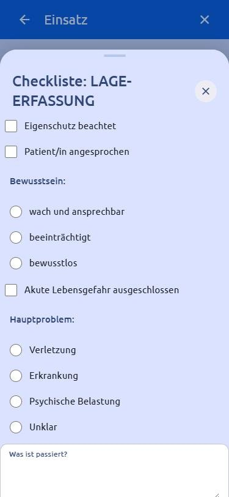

# Checklisten und Protokolle

## Checklisten und Formulare

{ .screenshot .screenshot-rechts }

Viele Einsatztätigkeiten folgen festen Abläufen – vom Lagebericht über das Überbringen einer Todesnachricht bis zum Führungskreislauf. Mit Checklisten hast du diese Abläufe im Einsatz sofort zur Hand.

1. Öffne die Einsatzübersicht deines Einsatzes.
2. Tippe auf eine Checkliste, z. B. **Checkliste: LAGE-ERFASSUNG**. Daneben siehst du, wie viele Punkte schon erledigt sind, z. B. **0/15**.
3. Arbeite die Punkte ab. Je nach Checkliste gibt es:
    - **Häkchen** für erledigte Schritte
    - **Auswahlfelder**, bei denen du eine Antwort wählst, z. B. beim Bewusstsein „wach und ansprechbar“, „beeinträchtigt“ oder „bewusstlos“
    - **Textfelder** für eigene Notizen, z. B. „Was ist passiert?“
4. Tippe auf **Speichern**.

Die Angaben aus Checklisten fließen in die Einsatzdokumentation ein und können im Protokoll mitgeschickt werden.

## Protokoll absenden

Am Ende eines Einsatzes kannst du die Einsatzdaten weitergeben – zum Beispiel an die Teamleitung oder an Führungskräfte.

1. Tippe in der Einsatzübersicht unter **Nachbereitung** auf **Einsatzprotokoll absenden**.
2. Der Besitzer deines Pakets hat eine **Vorauswahl** festgelegt, welche Einsatzdaten übermittelt werden. Du siehst sie in der Vorschau, zum Beispiel Alarmzeit und Einsatzstichwörter.
3. Möchtest du einen Teil der Daten nicht versenden, tippe auf **Daten zum Export manuell auswählen** und entferne ihn.
4. Tippe auf **An Server senden**.

!!! warning "Sensible Daten"
    Prüfe vor dem Absenden, welche Daten das Protokoll enthält. Wenn deine Organisation besonders sensible Daten verarbeitet, empfiehlt der VdUE einen eigenen HEiDi-Server.

!!! info "Gut zu wissen"
    Welche Exportvarianten es gibt – etwa ein formatiertes Protokoll zum Ausdrucken oder eine Textnachricht für Messenger – legt dein Paket fest.
