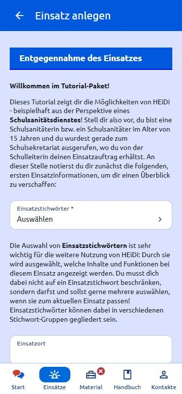
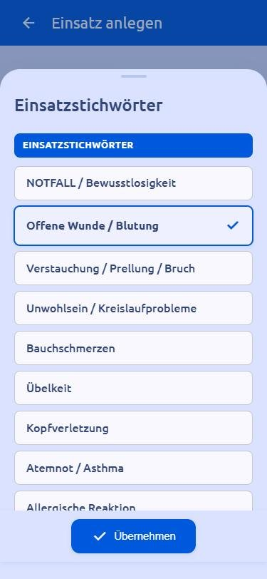
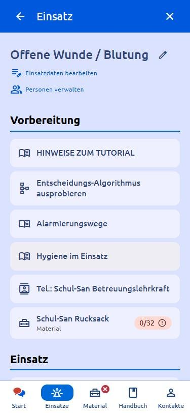
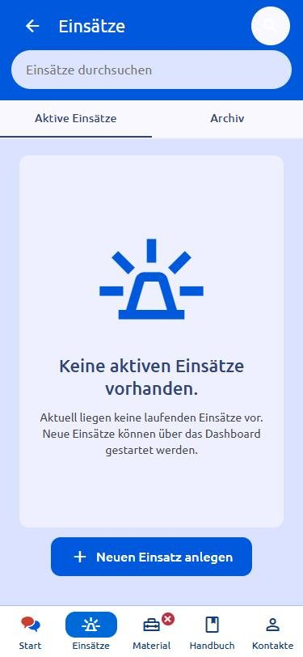

# Einsätze

Mit der Einsatzdokumentation hast du alle Informationen zu einem Einsatz an einer Stelle – von der Alarmierung bis zum Protokoll. Und: Die **Einsatzstichwörter**, die du auswählst, entscheiden, welche Inhalte und Funktionen dir HEiDi im Einsatz anzeigt.

## Einen Einsatz anlegen

{ .screenshot .screenshot-rechts }

1. Tippe auf der Startseite auf **neuen Einsatz anlegen** – oder im Bereich **Einsätze** auf **Neuen Einsatz anlegen**.
2. Tippe bei **Einsatzstichwörter** auf **Auswählen** und wähle ein oder mehrere Stichwörter, die zum Einsatz passen. Bestätige mit **Übernehmen**.
3. Prüfe die **Alarmzeit**. Sie ist mit der aktuellen Uhrzeit vorausgefüllt.
4. Fülle die weiteren Felder aus, soweit du die Informationen schon hast – zum Beispiel Einsatzort oder Notizen.
5. Unter **Beteiligte Personen** zählst du mit **+** und **−**, wie viele Personen beteiligt sind, ohne Namen erfassen zu müssen.
6. Tippe auf **Einsatz anlegen**.

Mit **Vorgang abbrechen** verwirfst du den Einsatz, ohne ihn zu speichern.

!!! tip "Lieber mehrere Stichwörter"
    Du musst dich nicht auf ein Stichwort beschränken. Wähle alle, die passen – dann zeigt dir HEiDi auch alle passenden Inhalte. Die Stichwörter können in Gruppen gegliedert sein, etwa nach Einsatzindikation, Betroffenen und Einsatzumgebung.

!!! info "Pflichtfelder"
    Felder mit einem Sternchen (\*) musst du ausfüllen, typischerweise **Einsatzstichwörter** und **Alarmzeit**. Welche Felder es sonst gibt und welche schon beim Anlegen abgefragt werden, legt dein Paket fest. Alles Weitere kannst du später ergänzen.

<figure markdown>
{ .screenshot }
<figcaption>Einsatzstichwörter auswählen</figcaption>
</figure>

## Die Einsatzübersicht

{ .screenshot .screenshot-rechts }

Nach dem Anlegen öffnet sich die **Einsatzübersicht** – das Herzstück von HEiDi. Sie zeigt dir, von oben nach unten, **nur die Inhalte, die zu deinen Einsatzstichwörtern passen**. Gegliedert ist sie in Abschnitte, zum Beispiel:

**Vorbereitung**
:   Was du vor dem Losgehen brauchst: Hinweise, Alarmierungswege, wichtige Kontakte, deinen Einsatzrucksack.

**Einsatz**
:   Checklisten und Handbuchartikel für die Situation vor Ort.

**Nachbereitung**
:   Hinweise zur Dokumentation, zum Umgang mit belastenden Einsätzen und zum Absenden des Protokolls.

Tippe auf einen Eintrag, um ihn zu öffnen. Was in welchem Abschnitt erscheint, legt dein Paket fest.

Ganz oben in der Einsatzübersicht findest du:

- das **Stift-Symbol** neben dem Einsatztitel und **Einsatzdaten bearbeiten** – um Informationen zu ergänzen oder zu ändern
- **Personen verwalten** – um beteiligte Personen in Gruppen zu erfassen, z. B. **Betreute Person** oder **Einsatzkräfte**

## Einen Einsatz abschließen

Ganz unten in der Einsatzübersicht tippst du auf **Einsatz abschließen**. Der Einsatz wandert dann im Bereich **Einsätze** vom Reiter **Aktive Einsätze** ins **Archiv**.

Hast du einen Einsatz zu früh abgeschlossen? Öffne ihn im **Archiv** und tippe auf **Einsatz wieder aktivieren**.

!!! tip "Erst das Protokoll, dann abschließen"
    Wenn dein Paket ein Einsatzprotokoll vorsieht, sende es am besten ab, bevor du den Einsatz abschließt – siehe [Checklisten und Protokolle](checklisten-und-protokolle.md#protokoll-absenden).

## Einsätze wiederfinden

{ .screenshot .screenshot-rechts }

Im Bereich **Einsätze** findest du:

- **Aktive Einsätze** – alle laufenden Einsätze
- **Archiv** – alle abgeschlossenen Einsätze

Über das Feld **Einsätze durchsuchen** findest du einen bestimmten Einsatz schnell wieder.

