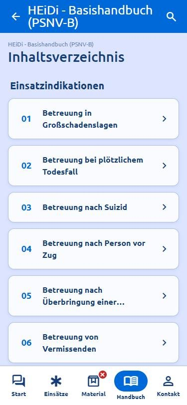
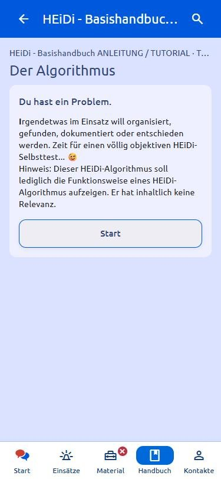

# Handbücher

Mit den Handbüchern hast du Taschenkarten, Regelwerke und Arbeitshilfen immer dabei – ohne zusätzliches Gewicht. Du kannst **mehrere Handbücher gleichzeitig** aktivieren.

## Ein Handbuch lesen

{ .screenshot .screenshot-rechts }

1. Tippe unten auf **Handbuch**.
2. Unter **Alle Handbücher** siehst du deine aktiven Handbücher mit der Zahl ihrer Kapitel. Tippe auf ein Handbuch.
3. Das **Inhaltsverzeichnis** ist in Kapitel gegliedert. Tippe auf eine Seite, um sie zu öffnen.
4. Mit dem Pfeil oben links kommst du **zur Seitenübersicht** zurück.

Unter **Zuletzt aufgerufen** findest du die Seiten, die du zuletzt geöffnet hast – auch auf der Startseite.

## Drei Arten von Inhalten

Handbuch-Artikel
:   Texte im Wikipedia-Stil. Sie können aufklappbare Abschnitte enthalten – tippe auf einen Abschnitt, um ihn zu öffnen. Artikel verlinken sich gegenseitig.

PDF-Dokument
:   Fertige Dokumente, etwa Satzungen, Flyer oder Dienstvorschriften, direkt in der App.

Algorithmus
:   Ein Entscheidungsbaum, der dich Schritt für Schritt durch eine Situation führt. Tippe auf **Start** und beantworte die Fragen.

<figure markdown>
{ .screenshot }
<figcaption>Algorithmus</figcaption>
</figure>

## Im Handbuch suchen

Tippe oben rechts auf die **Lupe** und gib einen Begriff in **Begriffe in Handbuch suchen** ein. HEiDi durchsucht den Text aller Seiten.

!!! tip "Handbuchinhalte im Einsatz"
    Passende Handbuchseiten erscheinen auch direkt in der [Einsatzübersicht](einsaetze.md#die-einsatzubersicht) – abhängig von den Einsatzstichwörtern. Du musst also im Einsatz nicht lange suchen.

Neue Handbücher lädst du unter Einstellungen › Handbücher – siehe [Pakete und Handbücher einrichten](../erste-schritte/pakete-und-handbuecher.md).
