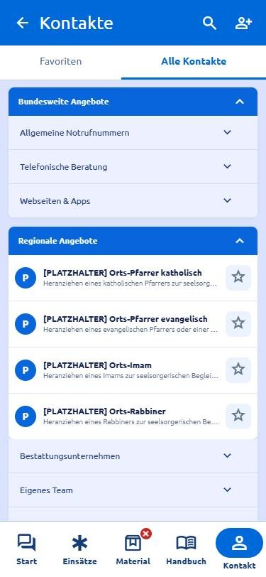

# Kontakte

{ .screenshot .screenshot-rechts }

Das Kontaktverzeichnis ist dein Nachschlagewerk für alle einsatzrelevanten Telefonnummern, Adressen und Webseiten – von Führungskräften deiner Organisation bis zu Beratungsstellen.

## Kontakte finden

1. Tippe unten auf **Kontakte**.
2. Unter **Alle Kontakte** sind die Einträge in Gruppen sortiert, zum Beispiel **Bundesweite Angebote** oder **Regionale Angebote**. Tippe auf eine Gruppe, um sie aufzuklappen.
3. Mit der **Lupe** oben rechts durchsuchst du alle Kontakte.

## Mit einem Tippen Kontakt aufnehmen

Je nach Art des Eintrags startet HEiDi mit einem Tippen

- einen **Anruf** (Telefonnummer),
- dein **Mailprogramm** (E-Mail-Adresse),
- deinen **Browser** (Webseite) oder
- dein **Navi** (Adresse).

## Favoriten

Tippe beim Kontakt auf den **Stern**. Er erscheint dann im Reiter **Favoriten** – so hast du die wichtigsten Nummern immer griffbereit.

## Eigene Kontakte

Über das Symbol mit der Person und dem Plus oben rechts fügst du einen eigenen Kontakt hinzu.

!!! info "Platzhalter in Basis-Paketen"
    Basis-Pakete enthalten manchmal Einträge wie **[PLATZHALTER] Orts-Pfarrer katholisch**. Sie sind als Vorlage gedacht: Deine Organisation ersetzt sie in ihrem eigenen Paket durch echte regionale Kontakte.
