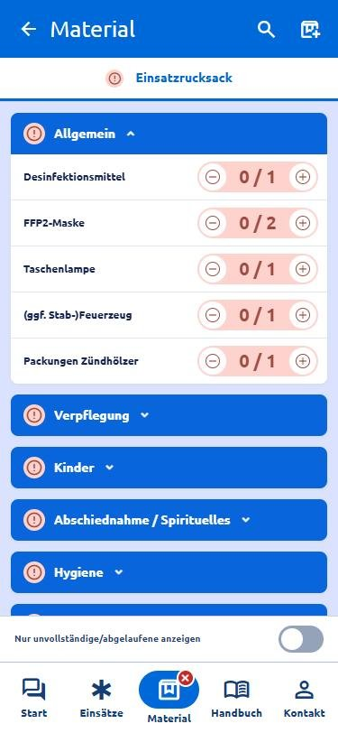

# Material

{ .screenshot .screenshot-rechts }

In der Materialverwaltung behältst du den Überblick über deine Ausrüstung – den Einsatzrucksack, das Fahrzeug oder die Einsatzleitertasche. So siehst du vor dem nächsten Einsatz sofort, ob alles da ist.

## Bestand prüfen und auffüllen

1. Tippe unten auf **Material**.
2. Die Gegenstände sind in Gruppen sortiert, zum Beispiel **Allgemein**, **Hygiene** oder **Verpflegung**. Tippe auf eine Gruppe, um sie auf- oder zuzuklappen.
3. Bei jedem Gegenstand steht der Bestand als **Ist / Soll**, z. B. **0 / 2** bei zwei FFP2-Masken.
4. Mit **+** und **−** passt du den Ist-Bestand an – etwa wenn du nach einem Einsatz Material verbraucht oder den Rucksack wieder aufgefüllt hast.

Mit **Alle unvollständigen auffüllen** setzt du alle Gegenstände auf einmal auf ihren Soll-Bestand – praktisch nach dem kompletten Auffüllen.

## Was fehlt?

- Ein **rotes Symbol** an der Gruppe, am Bereich **Material** in der unteren Leiste und auf der Startseite zeigt: Hier fehlt etwas.
- Schalte **Nur unvollständige/abgelaufene anzeigen** ein, um nur noch die Gegenstände zu sehen, um die du dich kümmern musst.

!!! info "Warum ist nach der Einrichtung alles rot?"
    Ein neu geladenes Paket startet mit leerem Bestand, z. B. **0/32**. Trage deinen tatsächlichen Bestand einmal ein – danach verschwinden die Warnsymbole.

## Eigene Gegenstände

Mit **Gegenstand hinzufügen** ergänzt du Ausrüstung, die in der Liste deines Pakets fehlt. Zu jedem Gegenstand kannst du optional eine **Beschreibung** (hilfreich für Neulinge) und ein **Haltbarkeitsdatum** hinterlegen. HEiDi weist dich dann rechtzeitig darauf hin, wenn etwas abläuft.

!!! tip "Material im Einsatz"
    Wenn dein Paket es vorsieht, erscheint dein Rucksack auch in der [Einsatzübersicht](einsaetze.md#die-einsatzubersicht) unter **Vorbereitung** – so prüfst du ihn direkt vor dem Losgehen.
