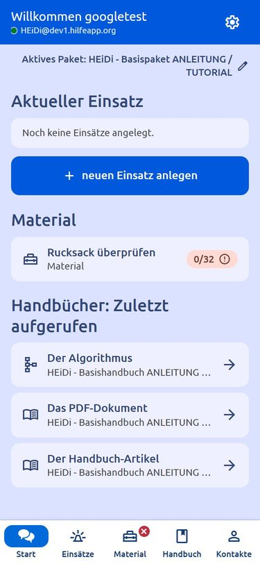

# Startseite

{ .screenshot .screenshot-rechts }

Die Startseite ist dein Überblick, bevor es losgeht. Du erreichst sie jederzeit über **Start** in der unteren Leiste.

Oben siehst du:

- **Willkommen** und deinen Benutzernamen
- darunter den **Server**, mit dem du verbunden bist – der grüne Punkt zeigt eine aktive Verbindung
- das Zahnrad für die [Einstellungen](../einstellungen.md)
- die Zeile **Aktives Paket** – mit dem Stift-Symbol wechselst du das Paket

Darunter folgen Karten:

**Aktueller Einsatz**
:   Dein laufender Einsatz. Mit **neuen Einsatz anlegen** startest du einen neuen – siehe [Einsätze](einsaetze.md).

**Material**
:   Wie vollständig dein Einsatzrucksack ist, z. B. **0/32**. Ein rotes Symbol zeigt, dass etwas fehlt – siehe [Material](material.md).

**Handbücher: Zuletzt aufgerufen**
:   Schnellzugriff auf die Handbuchseiten, die du zuletzt gelesen hast.

Je nach Einstellung kommen weitere Karten dazu, etwa **Paket-Updates**, **Handbuch-Updates** oder **Aktiver Login**.

!!! tip "Startseite anpassen"
    Unter Einstellungen › App Einstellungen › Dashboard-Karten legst du fest, welche Karten auf der Startseite erscheinen.
