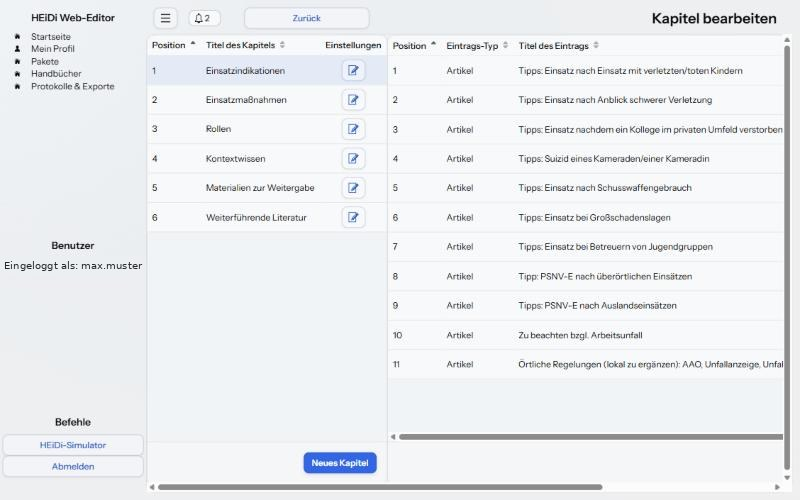

# Handbücher bearbeiten

Ein Handbuch bringt das Wissen in die App: Artikel, Algorithmen und PDF-Dokumente, geordnet in Kapitel. Unter **Handbücher** findest du alle Handbücher, an denen du mitarbeiten darfst.

Die Liste **Meine Handbücher** ist genauso aufgebaut wie die [Paketliste](pakete.md#die-paketliste). Mit **Neues Handbuch** legst du ein Handbuch an. Ein Klick auf ein Handbuch öffnet drei Bereiche:

| Bereich | Inhalt |
|---|---|
| **Einstellungen** | Name, Beschreibung und weitere Angaben zum Handbuch |
| **Kapitel & Artikel** | die Inhalte des Handbuchs |
| **Mitarbeiter** | wer im Editor mitarbeiten darf; die Rollen sind dieselben wie [bei Paketen](pakete.md#mitarbeiter) |

## Aufbau eines Handbuchs

Ein Handbuch ist in vier Ebenen gegliedert:

1. **Kapitel**, z. B. „Einsatzindikationen“ oder „Weiterführende Literatur“
2. **Einträge** in einem Kapitel: ein **Artikel**, ein **Algorithmus** oder ein **PDF-Dokument**
3. **Abschnitte** eines Artikels
4. **Elemente** eines Abschnitts, z. B. Textblöcke und Bilder

## Kapitel und Einträge

Unter **Kapitel & Artikel** stehen links die Kapitel. Klickst du auf ein Kapitel, erscheinen rechts seine Einträge.

{ .screenshot-desktop }

- **Neues Kapitel** legt ein Kapitel an, der Stift ändert Titel und Position.
- **Neuer Eintrag** legt einen Eintrag im gewählten Kapitel an. Dabei wählst du:
    - **Titel**
    - **Eintrags-Typ**: Artikel, Algorithmus oder PDF-Dokument
    - **Stichwörter**, unter denen der Eintrag gefunden wird
- Das Auge unter **Eintrag bearbeiten** öffnet den Inhalt.

!!! info "Einträge in der Einsatzübersicht"
    Mit einer [WENN-DANN-Regel](regeln.md) und der Aktion **Handbucheintrag anzeigen** blendest du einen Eintrag passend zum Einsatz in der App ein.

## Artikel schreiben

Ein Artikel besteht aus **Abschnitten**. Links legst du mit **Neu** einen Abschnitt an. Klickst du auf einen Abschnitt, siehst du rechts seine **Elemente**. Auch dort fügst du mit **Neu** etwas hinzu:

| Element-Typ | Wofür |
|---|---|
| **Überschrift** | gliedert den Artikel |
| **Textblock** | der eigentliche Text, mit Formatierung |
| **Ausklappbarer Text** | Text, den man in der App bei Bedarf aufklappt, z. B. für Hintergrundwissen |
| **Autorendetails** | wer den Artikel geschrieben oder geprüft hat |
| **Bild** | ein Foto oder eine Grafik |
| **Video** | ein Video |
| **PDF-Dokument** | ein PDF innerhalb des Artikels |

Die **Position** legt die Reihenfolge der Abschnitte und Elemente fest.

## Algorithmen und PDF-Dokumente

- Ein **Algorithmus** führt in der App mit Fragen Schritt für Schritt durch eine Situation. Seine Schritte bearbeitest du ebenfalls über **Eintrag bearbeiten**.
- Ein **PDF-Dokument** lädst du als Datei hoch. Es eignet sich für fertige Merkblätter, Formulare oder Materialien zur Weitergabe.

## Veröffentlichen

Wie bei Paketen erreichen deine Änderungen die App erst, wenn du das Handbuch in der Liste **Meine Handbücher** **veröffentlichst**. Danach bekommen alle, die das Handbuch nutzen, die neue Version.
