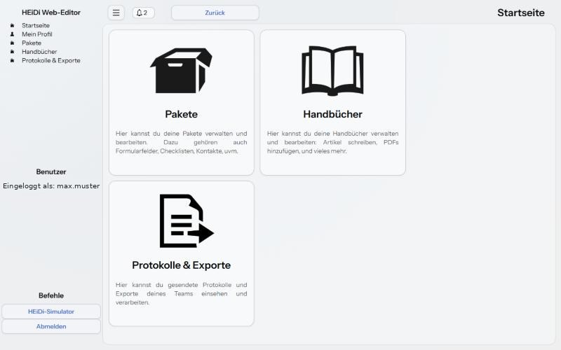

# Der HEiDi-Editor

Im **HEiDi-Editor** erstellst und pflegst du die Pakete und Handbücher, die später in der App erscheinen. Er läuft im Browser unter **[heidi.hilfeapp.org](https://heidi.hilfeapp.org)**, du musst also nichts installieren.

!!! warning "Neuer Editor seit dem 28. November 2026"
    Der bisherige Editor unter `editor.hilfeapp.org` gehört zur **bisherigen HEiDi**. Seit dem Content-Freeze am 27.11.2026 um 12 Uhr werden Änderungen dort nicht mehr übernommen.

    Inhalte für die **neue HEiDi** bearbeitest du ausschließlich unter **heidi.hilfeapp.org**. Deine Accounts, Pakete und Handbücher wurden übernommen.

## Anmelden

Öffne [heidi.hilfeapp.org](https://heidi.hilfeapp.org) und melde dich mit Benutzername und Passwort deines **HEiDi-Accounts** an. Das ist derselbe Account wie in der App. Hast du noch keinen, legst du ihn in der App an, wie unter [Registrieren und anmelden](../erste-schritte/registrieren-und-anmelden.md) beschrieben.

!!! tip "Großer Bildschirm empfohlen"
    Viele Ansichten im Editor sind breite Tabellen. Am besten arbeitest du am Computer oder Laptop.

## So ist der Editor aufgebaut

{ .screenshot-desktop }

| Bereich | Was du dort findest |
|---|---|
| **Seitenleiste links** | Startseite, Mein Profil, Pakete, Handbücher, Protokolle & Exporte, darunter **HEiDi-Simulator** und **Abmelden**. Mit dem Symbol ☰ blendest du sie ein und aus. |
| **Glocke oben** | Benachrichtigungen; die Zahl zeigt, wie viele neu sind |
| **Zurück** | eine Ebene nach oben, z. B. von einer Regel zurück zur Regelliste |
| **Titel oben rechts** | wo du dich gerade befindest |

Fast alle Inhalte sind Tabellen, die gleich funktionieren:

- **Position** legt die Reihenfolge fest, in der etwas in der App erscheint.
- Mit den Pfeilen neben einer Spaltenüberschrift sortierst du die Tabelle.
- Der **Ordner** oder das **Auge** öffnet den Inhalt eines Eintrags, z. B. die Items einer Materialliste.
- Der **Stift** unter **Einstellungen** öffnet die Eigenschaften eines Eintrags, z. B. Name und Position.
- Neue Einträge legst du mit dem blauen Button unten rechts an.

## Was du im Editor machst

-   :material-package-variant: **[Pakete bearbeiten](pakete.md)**

    ---

    Einsatzstichwörter, Formulare, Checklisten, Material und Kontakte eines Pakets einrichten.

-   :material-call-split: **[WENN-DANN-Regeln](regeln.md)**

    ---

    Festlegen, was die Einsatzübersicht der App zu welchem Einsatz anzeigt.

-   :material-book-open-variant: **[Handbücher bearbeiten](handbuecher.md)**

    ---

    Kapitel, Artikel, Algorithmen und PDF-Dokumente schreiben und ordnen.

## Vom Editor in die App

1. Du bearbeitest ein Paket oder Handbuch im Editor. Jede Änderung speicherst du direkt im jeweiligen Fenster.
2. Du prüfst das Ergebnis im **HEiDi-Simulator**.
3. Du **veröffentlichst** das Paket oder Handbuch. Dabei entsteht eine neue Version.
4. Die Apps laden die neue Version herunter, siehe [Pakete aktualisieren](../einstellungen.md#pakete).

## Mein Profil

Unter **Mein Profil** siehst du deine Benutzer-ID, deinen Benutzernamen und deine E-Mail-Adresse. Dort kannst du:

- deinen **Anzeigenamen** ändern,
- deine **Tätigkeitsbereiche und Organisationen** angeben,
- **E-Mail-Adresse**, **Benutzername** und **Passwort** ändern. Jede dieser Änderungen bestätigst du mit deinem aktuellen Passwort. Ein neues Passwort braucht mindestens 10 Zeichen.

## Protokolle & Exporte

Hier siehst du die Protokolle und Exporte, die dein Team aus der App gesendet hat, mit Anzahl und Datum des neuesten Eintrags. Ein Export entsteht, wenn in einem Paket die Aktion **Export versenden** eingerichtet ist, siehe [WENN-DANN-Regeln](regeln.md#dann-aktionen).

## HEiDi-Simulator

Der Button **HEiDi-Simulator** in der Seitenleiste zeigt die App in einem Smartphone-Rahmen direkt im Editor. So kannst du deine Änderungen ausprobieren, ohne ein Handy zur Hand zu haben.

Unter dem Simulator speicherst oder löschst du Testdaten: Rucksack, Fälle und das letzte Protokoll.
