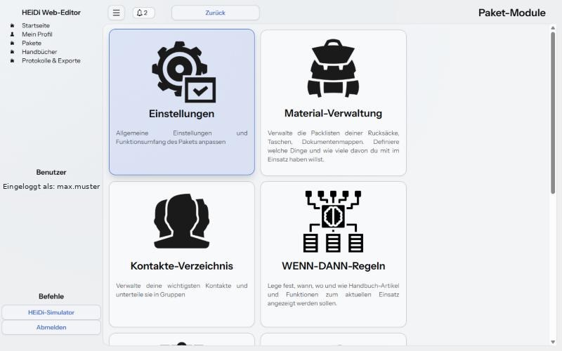
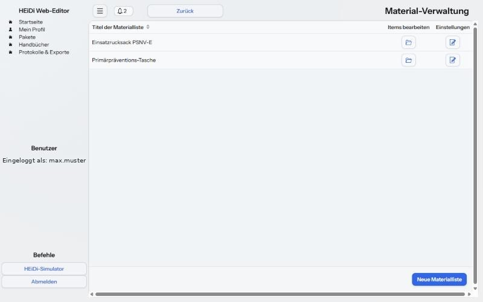
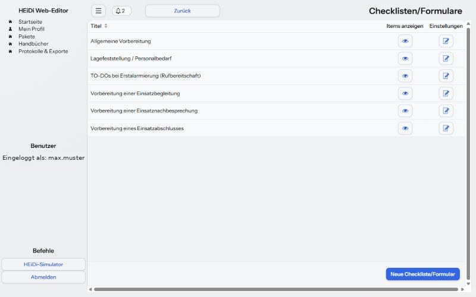
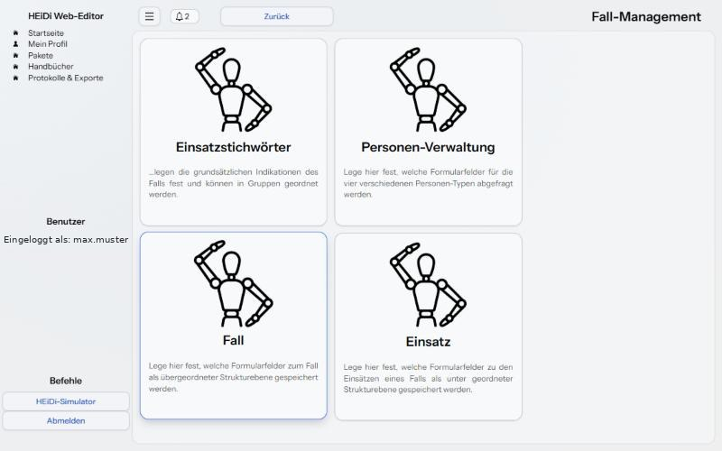

# Pakete bearbeiten

Ein Paket bringt die Funktionen der App mit: Einsatzstichwörter, Formularfelder, Checklisten, Materiallisten und Kontakte. Unter **Pakete** findest du alle Pakete, an denen du mitarbeiten darfst.

## Die Paketliste

Die Liste **Meine Pakete** zeigt zu jedem Paket:

| Spalte | Bedeutung |
|---|---|
| **Titel** | Name des Pakets |
| **Version** | wie oft das Paket bisher veröffentlicht wurde |
| **Build-Datum** | wann die aktuelle Version erstellt wurde |
| **Dateigröße** | Größe der Version, die die App herunterlädt |
| **Downloads** | wie oft das Paket heruntergeladen wurde |
| **Veröffentlichen** | stellt den aktuellen Stand als neue Version bereit, siehe [Veröffentlichen](#veroffentlichen) |

Mit **Neues Paket** legst du ein Paket an. Ein Klick auf ein Paket öffnet seine Module.

## Die Module eines Pakets

{ .screenshot-desktop }

| Modul | Was du dort festlegst | In der App |
|---|---|---|
| **[Einstellungen](#einstellungen)** | Name, Beschreibung, Funktionen, Passwort | Paketliste, Bereiche unten in der App |
| **[Material-Verwaltung](#material-verwaltung)** | Packlisten für Rucksäcke, Taschen, Mappen | [Material](../app/material.md) |
| **[Kontakte-Verzeichnis](#kontakte-verzeichnis)** | Kontakte in Gruppen | [Kontakte](../app/kontakte.md) |
| **[WENN-DANN-Regeln](regeln.md)** | was zu welchem Einsatz angezeigt wird | [Einsatzübersicht](../app/einsaetze.md) |
| **[Checklisten](#checklisten-und-formulare)** | Checklisten und Formulare | [Checklisten und Protokolle](../app/checklisten-und-protokolle.md) |
| **[Mitarbeiter](#mitarbeiter)** | wer im Editor mitarbeiten darf | – |
| **[Fall-Management](#fall-management)** | Einsatzstichwörter und Formularfelder | Einsatzformular |

## Einstellungen

| Abschnitt | Inhalt |
|---|---|
| **Grunddaten** | Icon, Anzeigename, Beschreibung und das **Prüfintervall** (Standard: 30 Tage) |
| **Empfohlene Handbücher** | Handbücher, die die App nach dem Download des Pakets vorschlägt |
| **Tätigkeitsbereiche** und **Organisationen** | helfen, das Paket in der App zu finden |
| **Funktionen** | Schalter für **Einsätze**, **Materialverwaltung**, **Kontakte** und **Handbücher**. Ausgeschaltete Funktionen erscheinen in der App nicht. |
| **Veröffentlichung** | Ist ein **Passwort zur Veröffentlichung** gesetzt, erscheint das Paket in der App als **passwortgeschützt**. |
| **Kopiereinstellungen** | **Kopieren erlauben**: ob andere das Paket als Vorlage übernehmen dürfen |

Änderungen übernimmst du mit **Speichern**.

## Material-Verwaltung

Material ist in drei Ebenen gegliedert:

1. **Materialliste**, z. B. „Einsatzrucksack“ oder „Primärpräventions-Tasche“
2. **Item-Gruppe** innerhalb der Liste, z. B. „Hygiene/Erste Hilfe“ oder „Verpflegung“
3. **Items**, also die einzelnen Dinge, mit der Menge, die vorhanden sein soll

{ .screenshot-desktop }

Mit dem Ordner-Symbol unter **Items bearbeiten** öffnest du die nächste Ebene. Neue Listen legst du mit **Neue Materialliste** an, neue Gruppen mit **Neue Item-Gruppe**.

## Kontakte-Verzeichnis

Kontakte ordnest du in **Kontakte-Gruppen**, z. B. „Allgemeine Angebote“ und „Organisationsspezifisch“. Über **Kontakte-Gruppe öffnen** bearbeitest du die Kontakte einer Gruppe.

## Checklisten und Formulare

Unter **Checklisten/Formulare** stehen alle Checklisten des Pakets. Das **Auge** unter **Items anzeigen** öffnet die Felder einer Checkliste; mit **Neues Item** fügst du ein Feld hinzu.

{ .screenshot-desktop }

| Feldart | Wofür |
|---|---|
| **Überschrift** | gliedert die Checkliste |
| **Statischer Text** | Hinweis oder Erklärung ohne Eingabe |
| **Checkbox** | zum Abhaken |
| **Zahl** | Zahleneingabe |
| **Datum & Uhrzeit**, **Datum**, **Uhrzeit** | Zeitpunkte |
| **Textfeld (einzeilig)**, **Textfeld (mehrzeilig)** | freie Texteingabe |
| **Single Choice** | genau eine Antwort aus einer Liste |
| **Multiple Choice** | mehrere Antworten aus einer Liste |
| **Single Choice (Popup-Fenster)**, **Multiple Choice (Popup-Fenster)** | wie oben, die Auswahl öffnet sich in einem eigenen Fenster; praktisch bei langen Listen |

Bei Auswahlfeldern legst du die Antworten über **Listeneinträge bearbeiten** fest.

!!! info "Wann erscheint eine Checkliste?"
    Eine Checkliste taucht in der Einsatzübersicht erst auf, wenn eine [WENN-DANN-Regel](regeln.md) sie mit der Aktion **Checkliste anzeigen** einblendet.

## Fall-Management

Hier legst du fest, welche Informationen zu einem Einsatz erfasst werden.

{ .screenshot-desktop }

| Bereich | Inhalt |
|---|---|
| **Einsatzstichwörter** | Die Stichwörter, die in der App bei einem Einsatz ausgewählt werden. Sie sind in **Stichwort-Gruppen** geordnet, z. B. „Einsatzindikation“ und „Einsatzmaßnahme“. |
| **Personen-Verwaltung** | Formularfelder für die vier Personengruppen **Index-Person**, **Betreute Person**, **Einsatzkräfte** und **Anwesende Person**. Mit **Bei Fall-Erstellung anzeigen** legst du fest, ob die Gruppe schon beim Anlegen abgefragt wird. |
| **Fall** | Formularfelder der übergeordneten Ebene. Ein Fall kann mehrere Einsätze enthalten. |
| **Einsatz** | Formularfelder für jeden einzelnen Einsatz eines Falls |

Die Einsatzstichwörter sind die wichtigste Stellschraube: Über sie steuern die [WENN-DANN-Regeln](regeln.md), was die Einsatzübersicht zeigt.

## Mitarbeiter

Unter **Mitarbeiter** (Seite **Berechtigungen**) legst du fest, wer an dem Paket im Editor mitarbeiten darf. Mit **Neuer Mitarbeiter** fügst du jemanden über den **Benutzernamen** hinzu und wählst eine **Rolle**:

| Rolle | Darf |
|---|---|
| **Besitzer** | alles; wird automatisch, wer das Paket angelegt hat |
| **Administrator** | alles, auch Mitarbeiter verwalten |
| **Rollenverwaltung** | Mitarbeiter und ihre Rollen verwalten |
| **Bearbeiter** | Inhalte bearbeiten |
| **Exporte-Einseher** | gesendete Protokolle und Exporte einsehen |
| **Betrachter** | Inhalte nur ansehen |

## Veröffentlichen

Solange du nur bearbeitest, ändert sich in der App nichts. Erst **Veröffentlichen** in der Paketliste erstellt eine neue **Version**. Danach zeigt die App bei allen, die das Paket nutzen, eine Aktualisierung an.

!!! tip "Vorher testen"
    Prüfe deine Änderungen im **HEiDi-Simulator**, bevor du veröffentlichst. Eine veröffentlichte Version landet bei allen Nutzerinnen und Nutzern des Pakets.
