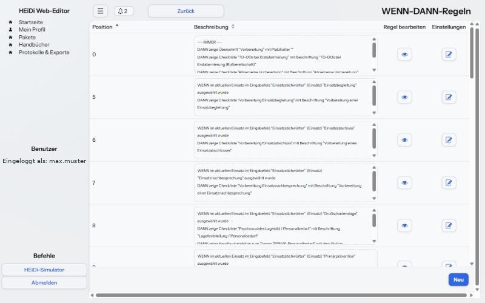
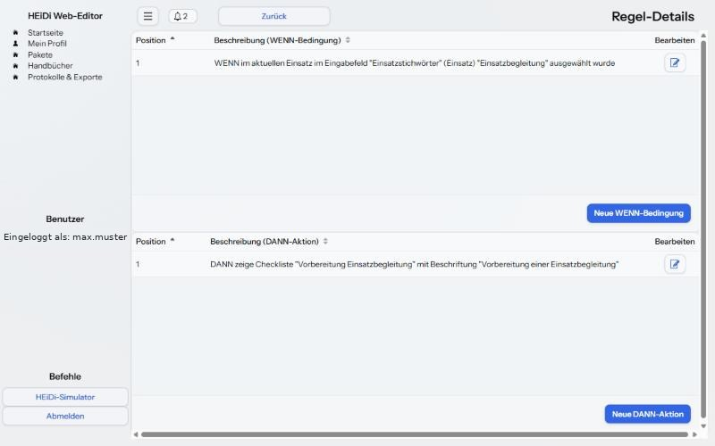
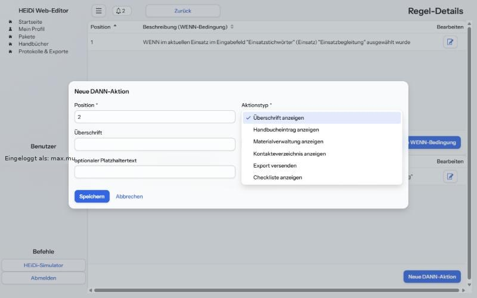

# WENN-DANN-Regeln

Die WENN-DANN-Regeln legen fest, was die [Einsatzübersicht](../app/einsaetze.md) in der App zu einem Einsatz zeigt. Zum Beispiel: Wird bei einem Einsatz das Stichwort „Einsatzbegleitung“ gewählt, blendet HEiDi die passende Checkliste ein.

Du findest die Regeln im Paket unter **WENN-DANN-Regeln**.

{ .screenshot-desktop }

## Aufbau einer Regel

Jede Regel besteht aus zwei Teilen:

- **WENN-Bedingungen:** wann die Regel greift, z. B. „im Eingabefeld Einsatzstichwörter wurde *Einsatzbegleitung* ausgewählt“
- **DANN-Aktionen:** was dann angezeigt wird, z. B. „zeige Checkliste *Vorbereitung Einsatzbegleitung*“

Eine Regel ohne WENN-Bedingung gilt **immer**. In der Liste steht dann `--- IMMER ---`. So zeigst du Inhalte, die bei jedem Einsatz erscheinen sollen, etwa eine allgemeine Vorbereitung.

Die **Position** einer Regel bestimmt, in welcher Reihenfolge ihre Inhalte in der Einsatzübersicht erscheinen. Die Spalte **Beschreibung** fasst jede Regel in Klartext zusammen.

## Eine Regel bearbeiten

1. Klicke in der Regelliste beim gewünschten Eintrag unter **Regel bearbeiten** auf das Auge.
2. Die **Regel-Details** zeigen oben die WENN-Bedingungen und unten die DANN-Aktionen.
3. Mit **Neue WENN-Bedingung** bzw. **Neue DANN-Aktion** fügst du etwas hinzu. Mit dem Stift unter **Bearbeiten** änderst du einen vorhandenen Eintrag.

{ .screenshot-desktop }

Eine neue Regel legst du in der Regelliste mit **Neu** an.

## WENN-Bedingungen

Eine Bedingung bezieht sich auf ein Eingabefeld aus einer dieser **Feldgruppen**:

| Feldgruppe | Beispiel |
|---|---|
| **Einsatz** | ein bestimmtes Einsatzstichwort wurde ausgewählt |
| **Fall** | ein Feld des übergeordneten Falls hat einen bestimmten Wert |
| **Person** | ein Feld einer Person, z. B. der betreuten Person |
| **Checklisten** | ein Feld einer Checkliste wurde ausgefüllt |

Mit **Bedingung umkehren (WENN NICHT …)** greift die Bedingung genau dann, wenn das Gegenteil zutrifft.

## DANN-Aktionen

| Aktionstyp | Was die App zeigt |
|---|---|
| **Überschrift anzeigen** | eine Zwischenüberschrift in der Einsatzübersicht, z. B. „Vorbereitung“; optional mit Platzhaltertext |
| **Checkliste anzeigen** | eine Checkliste aus dem Paket, mit eigener Beschriftung |
| **Handbucheintrag anzeigen** | einen Artikel, ein PDF oder einen Algorithmus aus einem Handbuch |
| **Materialverwaltung anzeigen** | eine Materialliste |
| **Kontakteverzeichnis anzeigen** | Kontakte aus dem Kontakte-Verzeichnis |
| **Export versenden** | die Möglichkeit, die Einsatzdaten als Export zu verschicken; gesendete Exporte erscheinen im Editor unter **Protokolle & Exporte** |

{ .screenshot-desktop }

## Beispiel aus dem Basispaket

| | |
|---|---|
| **WENN** | im aktuellen Einsatz im Eingabefeld „Einsatzstichwörter“ „Einsatzbegleitung“ ausgewählt wurde |
| **DANN** | zeige Checkliste „Vorbereitung Einsatzbegleitung“ mit Beschriftung „Vorbereitung einer Einsatzbegleitung“ |

Wählt jemand in der App das Stichwort „Einsatzbegleitung“, erscheint die Checkliste in der Einsatzübersicht. Ohne das Stichwort bleibt sie ausgeblendet.

!!! tip "Erst das Stichwort, dann die Regel"
    Eine Regel kann nur Stichwörter und Checklisten verwenden, die es im Paket schon gibt. Lege deshalb zuerst die [Einsatzstichwörter](pakete.md#fall-management) und [Checklisten](pakete.md#checklisten-und-formulare) an und danach die Regel.
