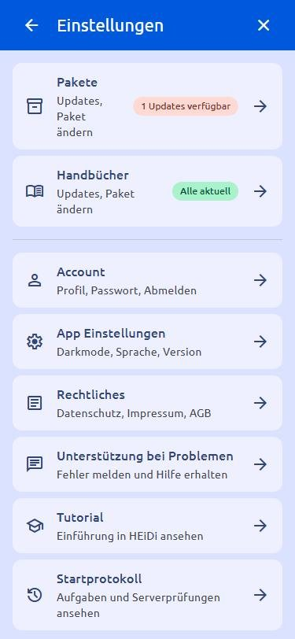
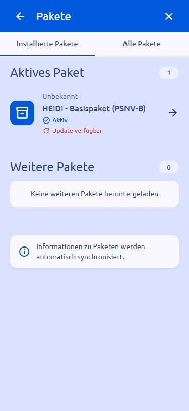

# Einstellungen

{ .screenshot .screenshot-rechts }

Die Einstellungen öffnest du über das **Zahnrad** oben rechts auf der Startseite.

| Eintrag | Was du dort machst |
|---|---|
| **[Pakete](#pakete)** | Pakete aktualisieren, wechseln, hinzufügen |
| **[Handbücher](#handbucher)** | Handbücher aktualisieren, aktivieren, hinzufügen |
| **[Account](#account)** | Profil, Passwort, Abmelden, weitere Logins |
| **[App Einstellungen](#app-einstellungen)** | Darkmode, Darstellung, Startseite |
| **Rechtliches** | Datenschutz, AGB, Impressum, Lizenzen |
| **Unterstützung bei Problemen** | Fehler melden und Hilfe erhalten |
| **Tutorial** | die Einführung in HEiDi noch einmal ansehen |
| **[Startprotokoll](#startprotokoll)** | prüfen, ob beim Start alles geklappt hat |

## Pakete

{ .screenshot .screenshot-rechts }

Unter **Pakete** gibt es zwei Reiter:

**Installierte Pakete**
:   Oben dein **Aktives Paket**, darunter **Weitere Pakete**, die du schon heruntergeladen hast. Steht bei einem Paket **Update verfügbar**, tippe darauf, um die neue Version zu laden.

**Alle Pakete**
:   Alle Pakete, die du herunterladen kannst – siehe [Pakete und Handbücher einrichten](erste-schritte/pakete-und-handbuecher.md).

Um das aktive Paket zu wechseln, tippe auf ein installiertes Paket und aktiviere es. Es ist immer genau **ein** Paket aktiv.

!!! tip "Updates"
    Ein Hinweis wie **1 Updates verfügbar** in den Einstellungen zeigt dir, dass es eine neue Version eines Pakets gibt. Lade Updates am besten vor dem Dienst, solange du Netz hast.

## Handbücher

Funktioniert wie die Pakete, mit den Reitern **Installierte Handbücher** und **Alle Handbücher**. Anders als bei Paketen kannst du **mehrere Handbücher gleichzeitig aktiv** haben.

In den Details eines installierten Handbuchs kannst du es

- mit **Handbuch deaktivieren** vorübergehend ausblenden oder
- mit **Handbuch löschen** von deinem Gerät entfernen.

## Account

Unter **Account** siehst du deine **Benutzeraccounts** – mit Benutzername, Server und wann du zuletzt aktiv warst.

- **Weiteren Login hinzufügen** – mit einem zweiten bestehenden Account anmelden, z. B. für eine andere Organisation
- **Neuen Account registrieren** – einen weiteren Account anlegen
- Mit dem **Stift-Symbol** bearbeitest du dein Profil.

## App Einstellungen

| Einstellung | Bedeutung |
|---|---|
| **Darkmode** | dunkle Darstellung, angenehm bei Nacht |
| **Gerätename** | Name, unter dem dieses Gerät angezeigt wird |
| **Handbuch-Details Design** | Details als **Slider (Bottom-Sheet)** von unten oder als **Eigenständige Seite** |
| **Paket-Details Design** | dasselbe für Pakete |
| **Dashboard-Karten** | welche Karten auf der [Startseite](app/startseite.md) erscheinen |

## Startprotokoll

Das **Startprotokoll** listet auf, was HEiDi beim Start prüft – etwa ob das aktive Paket heruntergeladen ist, ob die Anmeldung gültig ist und ob Paket- und Handbuchlisten aktualisiert wurden. Jeder Schritt ist als **Erfolgreich** oder **Fehler** markiert.

Wenn etwas nicht funktioniert, hilft ein Blick ins Startprotokoll – und ein Screenshot davon hilft dem HEiDi-Team bei der Fehlersuche. Mit **Logs löschen** leerst du das Protokoll.
