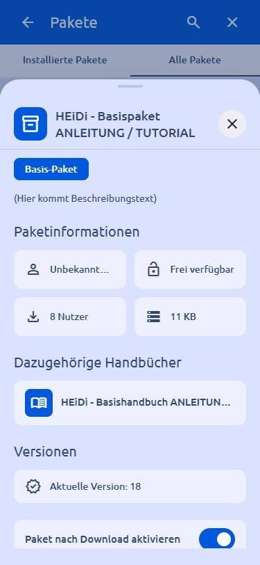
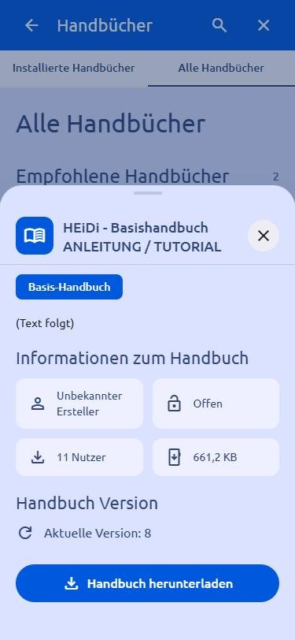

# Pakete und Handbücher einrichten

Nach der Anmeldung ist HEiDi noch leer. Jetzt lädst du ein **Paket** (die Funktionen) und ein oder mehrere **Handbücher** (das Wissen). Was genau dahintersteckt, erklärt die Seite [Was ist HEiDi?](was-ist-heidi.md).

## Bei der ersten Anmeldung

1. Blättere mit **Weiter** durch die kurze **Einführung** – oder tippe auf **Einführung überspringen**.
2. Tippe auf **zur Paketauswahl**.
3. Wähle ein Paket aus. Für den Einstieg eignen sich die **Basis-Pakete**, zum Beispiel:
    - **HEiDi – Basispaket ANLEITUNG / TUTORIAL** – zeigt alle Funktionen am Beispiel eines Schulsanitätsdienstes
    - **HEiDi – Basispaket (PSNV-B)** – für Krisenintervention und Notfallseelsorge
4. Tippe auf **Paket herunterladen**.
5. HEiDi schlägt dir anschließend die **dazugehörigen Handbücher** vor. Wähle eines aus und tippe auf **Handbuch herunterladen**.
6. Die Frage nach weiteren Handbüchern beantwortest du mit **Ja** oder **Nein, weiter**.
7. Unter **Alles bereit!** tippst du auf **In die App starten**.

<figure markdown>
{ .screenshot }
<figcaption>Paketdetails</figcaption>
</figure>
<figure markdown>
{ .screenshot }
<figcaption>Handbuchdetails</figcaption>
</figure>

## Später ein anderes Paket oder Handbuch laden

Du kannst jederzeit weitere Pakete und Handbücher hinzufügen:

- **Pakete:** Einstellungen › Pakete › Alle Pakete – oder auf der Startseite auf das Stift-Symbol neben **Aktives Paket** tippen.
- **Handbücher:** Einstellungen › Handbücher › Alle Handbücher

Tippe auf einen Eintrag, um seine Details zu sehen, und dann auf **Paket herunterladen** bzw. **Handbuch herunterladen**. Ist der Schalter **Paket nach Download aktivieren** eingeschaltet, arbeitest du danach direkt mit dem neuen Paket.

!!! info "Frei verfügbar oder passwortgeschützt?"
    In der Liste steht bei jedem Paket und Handbuch, ob es **Frei verfügbar** oder **Passwortgeschützt** ist. Für geschützte Inhalte bekommst du das Passwort von der Organisation, die sie erstellt hat.

## Die Liste der Pakete und Handbücher

Die Listen sind in Bereiche gegliedert:

| Bereich | Was du dort findest |
|---|---|
| **Empfohlene Handbücher** | Handbücher, die zu deinem aktiven Paket gehören |
| **Basis-Pakete** / **Basis-Handbücher** | Vorlagen des VdUE zum Einstieg |
| **Verifizierte Pakete** / **Verifizierte Handbücher** | vom VdUE geprüfte Inhalte |
| **Private Pakete** / **Private Handbücher** | Inhalte einzelner Organisationen |

Über die Lupe oben rechts kannst du die Listen durchsuchen.

Wie du installierte Pakete aktualisierst, wechselst oder löschst, steht unter [Einstellungen](../einstellungen.md#pakete).
